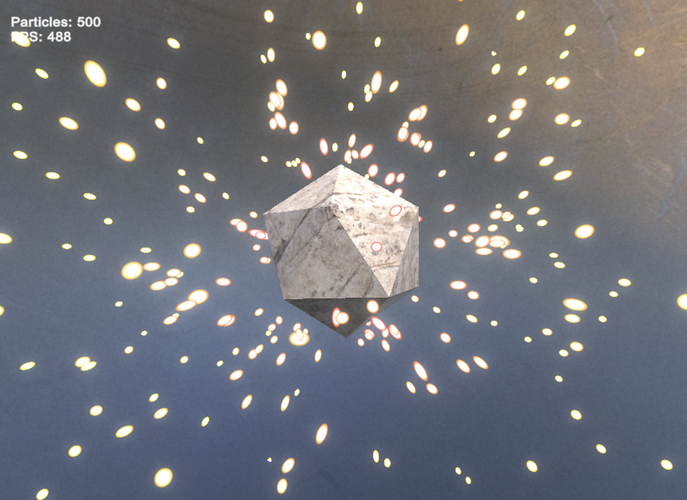
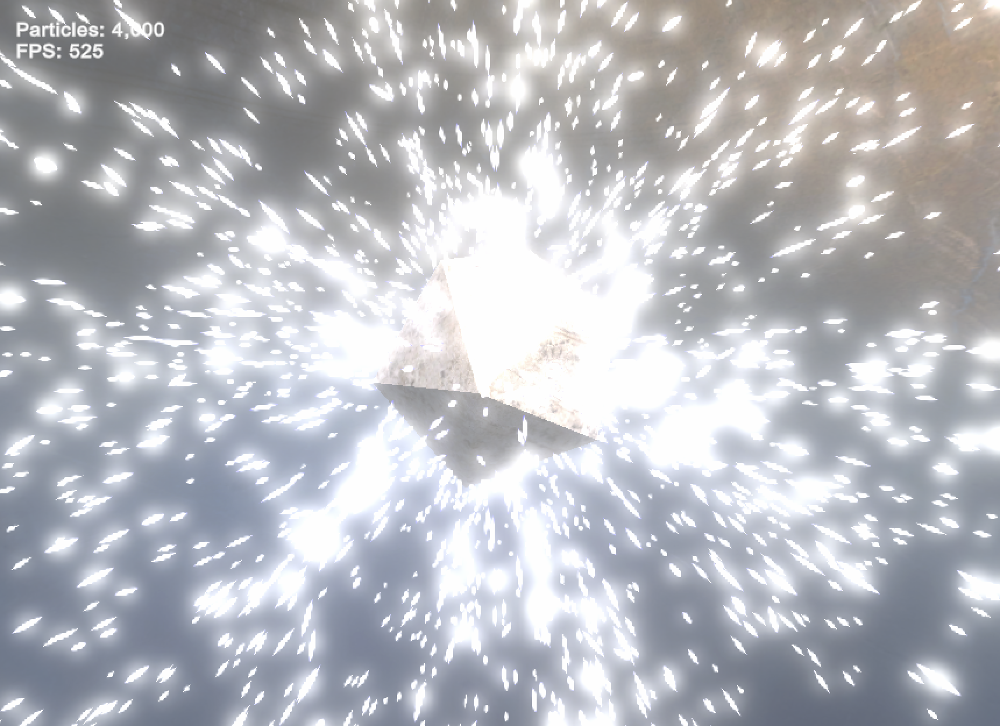

# Unity GPU Particles

A particle simulation in Unity using compute shaders and the Universal Render Pipeline (URP). Particles bounce off a rotating D20 object and respawn on an outer sphere.

## Features

- GPU particle simulation and collisions with the D20 object.
- GPU initialization with random positions and velocities on startup and particle-count changes.
- Automatic respawning on the outer sphere when a particle reaches it moving outward.
- Camera-facing particle billboards with velocity-based stretching.
- Particle colors based on distance to the D20 object's surface.
- Adjustable particle glow, bloom, and film grain.
- On-screen particle count and FPS.

## Requirements

- **Unity 6.3 LTS, version 6000.3.22f1**.
- **URP 17.3.0**, restored automatically from the project's package files.
- A GPU and graphics API that support [Unity compute shaders](https://docs.unity3d.com/6000.3/Documentation/Manual/class-ComputeShader-introduction.html), such as Metal on macOS or DirectX 11/12 on Windows.

## Run the demo

1. Clone this repository.
2. Add the repository folder to Unity Hub and open it with Unity **6000.3.22f1**.
3. Wait for Unity to restore packages and import the assets.
4. Use **File > Open Scene** to open `Assets/Scenes/Particles.unity`.
5. Press **Play**.

The scene starts with **500 particles**. Select the **Particles** object in the Hierarchy to adjust its **Particle Controller** settings in the Inspector, before or during Play mode. The D20 object rotates automatically.

## Settings

| Setting | Description |
| --- | --- |
| Particle Count | Number of particles, clamped to 1–1,000,000. |
| Particle Size | Size of the particle billboards. |
| Min Speed / Max Speed | Range of initial particle speeds. |
| Velocity Stretch | Stretch the billboards along their movement direction in camera space. |
| D20 Rotation Speed | Rotation speed around each world axis, in degrees per second. |
| Near Particle Color / Far Particle Color | Colors used near and far from the D20 object's surface. |
| Enable Glow / Glow Color / Glow Intensity / Glow Sharpness | Control the glow within each particle. |
| Bloom Amount / Film Grain Amount | Control the post-processing effects. |

Changing Particle Count recreates the particle buffer and restarts the particles. The upper limit is a code limit, not a performance guarantee; performance depends on the GPU and settings. Inspector changes made during Play mode are temporary.

## Source files

| File | Purpose |
| --- | --- |
| [ParticleController.cs](Assets/Scripts/ParticleController.cs) | Initializes GPU buffers, extracts D20 collision planes, updates settings, dispatches the simulation, and draws the particles and FPS display. |
| [Particle.compute](Assets/Shaders/Particle.compute) | Initializes particles, updates their positions, respawns them at the outer sphere, and resolves D20 collisions on the GPU. |
| [Particle.shader](Assets/Shaders/Particle.shader) | Creates particle billboards and applies stretching, surface-distance colors, glow, and soft circular edges. |

Particle positions and velocities are stored in a GPU buffer. The D20 object's mesh faces are converted to local-space planes at startup for collision checks.
